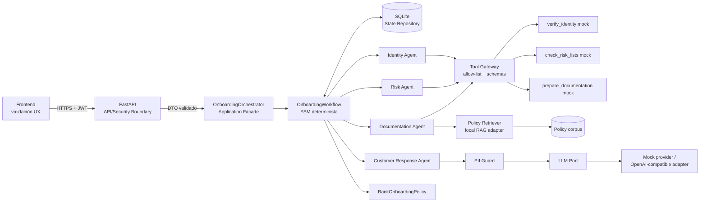

# Arquitectura — fase 2

## Objetivo

Mantener una frontera clara entre canal, seguridad, coordinación, decisión determinista, agentes, herramientas externas y capacidades probabilísticas.

## Trust boundaries

### 1. Frontend -> FastAPI

El frontend valida para UX, pero el backend vuelve a aplicar validación autoritativa. FastAPI también valida JWT, scopes y tamaño de request. Campos extra se rechazan.

### 2. FastAPI -> aplicación

El API mapea el DTO HTTP hacia `OnboardingRequest`. Los agentes y el workflow no son endpoints públicos.

### 3. Workflow -> agentes

El `OnboardingWorkflow` define explícitamente los estados y transiciones permitidas. Los agentes devuelven resultados, pero no pueden seleccionar el siguiente paso.

### 4. Agentes -> tools

`ToolGateway` es un policy enforcement point. Verifica tanto el agente autorizado como el esquema exacto de argumentos antes de ejecutar una tool.

### 5. Aplicación -> LLM

El LLM sólo participa en wording. El prompt se construye desde datos no PII y pasa por `PIIGuard`. La decisión ya fue calculada antes de llamar al modelo.

## Decisión y RAG

El retriever recupera evidencia de políticas para el producto. La documentación devuelta por la tool se contrasta contra esa evidencia. Si no existe evidencia suficiente o hay inconsistencia, el proceso no aprueba automáticamente.

El RAG aporta evidencia; no sustituye las reglas de negocio.

## Estado y auditoría

Cada transición genera un evento interno y persiste el estado. El API público no expone el audit log ni el texto del corpus de políticas.
